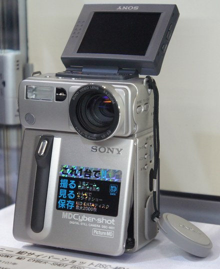
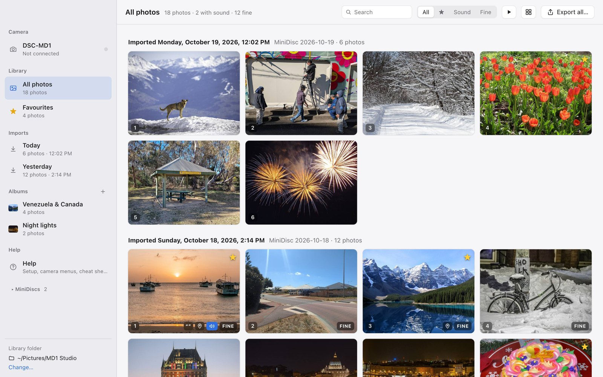
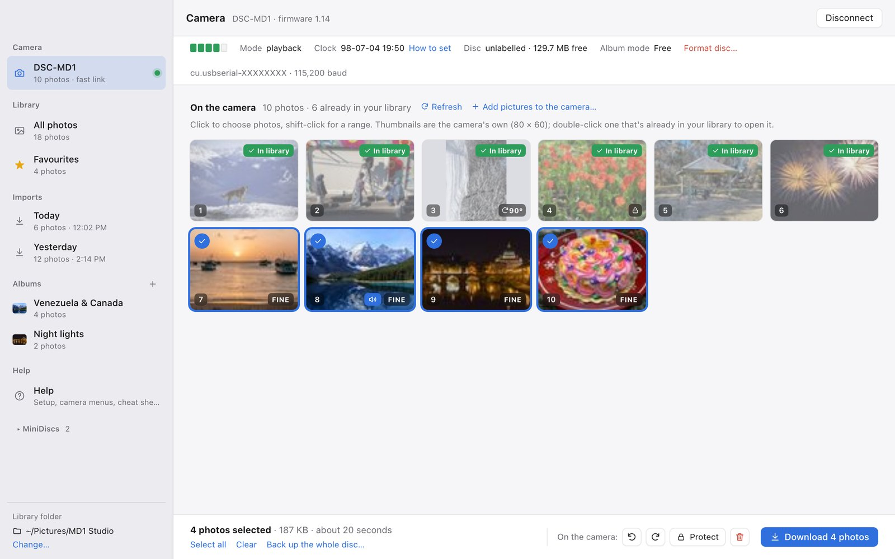
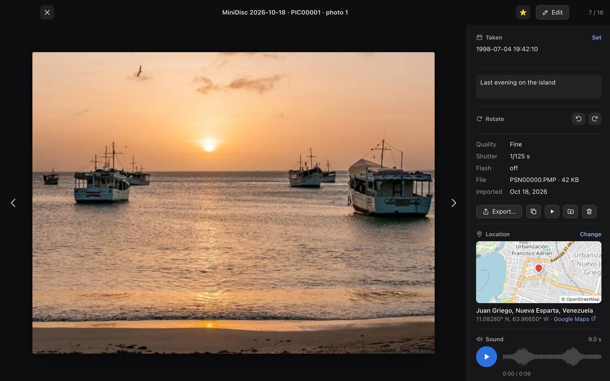
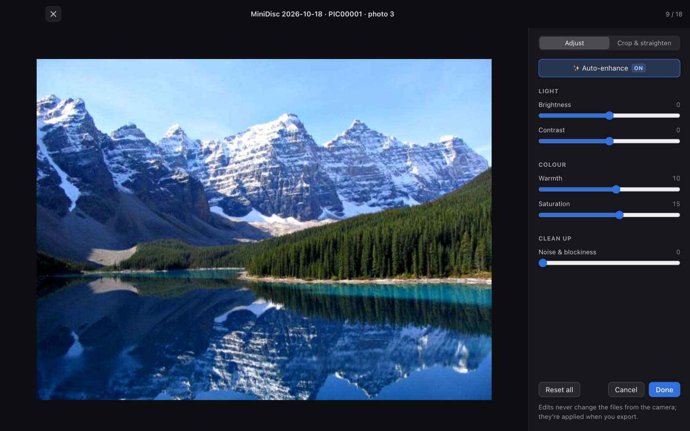
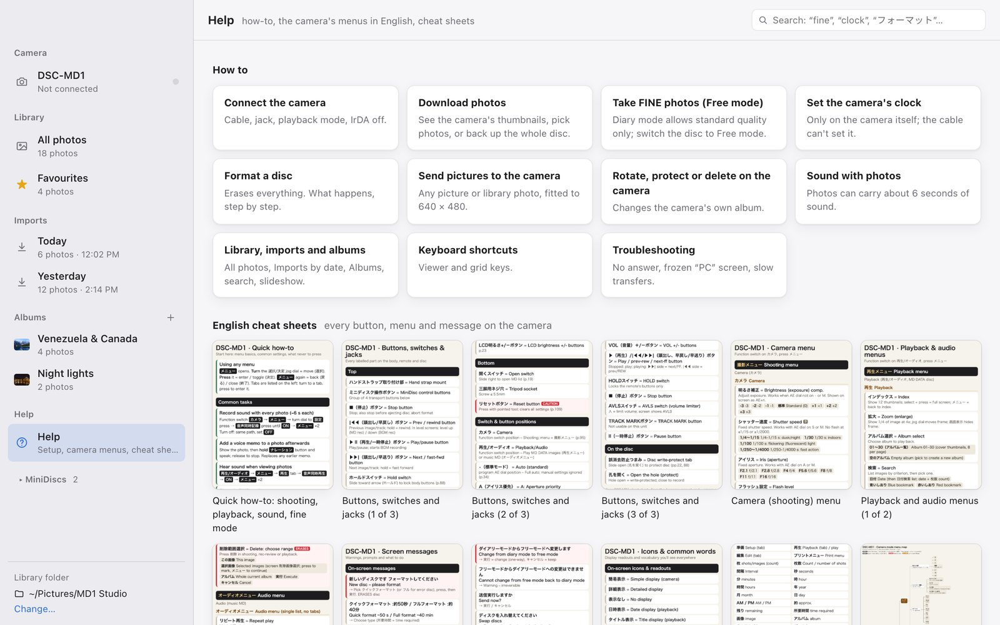

# MD1 Studio



Get your photos **and the sound recorded with them** off a **Sony DSC-MD1** "MD Cyber-shot"
(1997), the camera that saved 640×480 JPEGs onto MiniDisc (MD DATA) discs. You'll need a
modern Mac, Windows or Linux computer and about $20 of serial cables.

The camera was only ever sold in Japan. Its PC kit (software plus cable) is long gone, and the
software runs only on Windows 95 and classic Mac OS. This project works out how the camera talks
over its serial port and provides:

* **MD1 Studio**, a desktop app that shows you what's on the camera, downloads the photos you
  pick (with their sound) into one library, lets you add places, dates and captions and fix up
  the pictures, and exports ordinary JPEGs and WAVs.
* **Full documentation** of the serial protocol and the on-disc formats, including the
  hidden ATRAC sound files that Sony's own PC software never read.
* **English cheat sheets** for the Japanese-only camera.

<br clear="right">



<table>
<tr>
<td></td>
<td></td>
<td></td>
</tr>
<tr>
<td align="center"><sub>Camera: pick photos from the camera's thumbnails; ones you already have are marked</sub></td>
<td align="center"><sub>Viewer: shot details, caption, place on a map, and the photo's sound</sub></td>
<td align="center"><sub>Editor: auto-enhance, light and colour, noise cleanup, crop and straighten</sub></td>
</tr>
</table>



<sub>The screenshots use public-domain sample photos ([credits](docs/images/CREDITS.md)) and made-up sounds.</sub>

## Features

**Getting photos off the camera**
* Finds the camera automatically and switches the link to its top speed (115,200 baud, about
  10 seconds a photo).
* **Shows what's on the camera before downloading anything**, using the camera's own
  thumbnails (a few seconds per photo the first time, instant for a disc it has seen before;
  you can also choose to load them only when you ask). Photos already in your library are
  marked, even if they came from another disc or a restored copy.
* **Download just the new photos, or pick a few** (click, shift-click for a range). Their sound
  comes with them.
* Or **back up the whole disc** byte for byte (every file, including the index files), so it
  can be restored later.
* Decodes the camera's **sound recordings** (mono ATRAC1) to WAV.
* **Safe by design.** Downloading only ever reads. Anything that changes the disc asks first
  (see [Be careful with your disc](#be-careful-with-your-disc)).

**Managing the camera's disc** (asks first; every file written is read back to check it)
* **Send any picture to the camera**: library photos (with your edits) or JPEG, PNG, TIFF, BMP,
  GIF and WebP files, fitted or cropped to 640 × 480 at standard or fine quality, added to the
  end of the album like photos the camera took.
* **Rotate, protect or delete photos on the camera**, in the camera's own album index. Deleting
  warns you (and makes you type DELETE) if a photo isn't in your library yet; protected photos
  are left alone.
* **Format the disc**, behind three separate confirmations, with what will happen spelled out
  before and the next steps after (switch the camera off and on, Diary vs Free mode).
* Shows the disc's **album mode** (Diary: standard quality only; Free: FINE allowed) and how to
  switch it on the camera, and how to set the camera's clock (the cable can't).
* **Delete photos from the library** (to the Trash).

**Browsing**
* **One library** of every photo you've downloaded, like Lightroom or Apple Photos: All Photos,
  Favourites and each **Import** by date, with badges for sound, place, caption and FINE quality.
  Filter by favourites, sound or quality, or **search** captions, places and dates.
* **Albums** you make yourself, with a cover photo.
* **Slideshow with sound**: each photo stays up while its recorded sound plays.
* A full-screen viewer with keyboard navigation and pinch/scroll zoom; the zoom level carries
  over from photo to photo, including zooming out to smaller than the window.
* A sound player with a waveform, plus optional auto-play and loop.
* Shot details read from the camera's own records: date and time, shutter speed, flash and
  quality.

**Organizing**
* **Places**: search for a place (OpenStreetMap; no account needed), paste coordinates, or
  paste a Google or Apple Maps link. Each place gets a map preview.
* **Dates**: fix the date and time on one photo or many at once. You can also keep the gaps
  between shots, which helps when the camera's clock battery has died.
* Rotate photos, mark **favourites** and add **captions**.
* Shift-click, ⌘/Ctrl-click and ⌘/Ctrl-A select several photos for batch edits.

**Help built in**
* How-to topics (connecting, FINE photos and Free mode, the clock, formatting, sending pictures,
  troubleshooting), the English cheat sheets to zoom into, and a search across them and every
  translated camera menu, button and on-screen message (English or Japanese).

**Editing** (your original files are never changed)
* One-click **auto-enhance**, tuned for the camera's colour casts.
* Brightness, contrast, warmth and saturation.
* **Noise and JPEG-blockiness cleanup**.
* Crop with aspect presets, straighten (±15°), rotate and flip.

**Exporting**
* JPEGs with real **EXIF and XMP** metadata (date, GPS, caption, ★ rating, camera model,
  shutter, flash) that photo apps such as Apple Photos and Lightroom read.
* Optional **2× or 3× upscaling** (Lanczos plus light sharpening).
* **PNG or TIFF** instead, for lossless copies.
* A matching `.wav` alongside every photo that has sound.
* **Copy a photo** to the clipboard (⌘C in the viewer).
* **Contact sheets** to print: pages of thumbnails with dates or captions, 3–6 per row, Letter
  or A4.

## What you need

| Item | Notes |
|---|---|
| A Sony **DSC-MD1** | Firmware 1.14 is the version tested. The related DSC-F1 uses a similar protocol but hasn't been tried with the app. |
| A **USB-to-RS-232 adapter with an FTDI chip**, for example [OIKWAN USB to RS232 (FTDI)](https://www.amazon.com/dp/B0759HSLP1) | FTDI drivers come with macOS and Linux and install from Windows Update. Cheap Prolific/CH340 adapters may work but are untested. |
| A **DB9 female to 3.5 mm stereo plug RS-232 cable**, for example [Qaoquda DB9 to 3.5 mm](https://www.amazon.com/dp/B06WLP4LTP) | Works as sold; no null-modem adapter needed. This plugs into the camera's DIGITAL I/O jack. |
| The camera's AC adapter or a full battery | A transfer stalls if the camera powers off partway through. |

These aren't affiliate links, and any adapter and cable with the same wiring should work
(DB9 pins 2, 3 and 5 to the plug's tip, ring and sleeve).

### Set up the camera

1. Power it from the AC adapter or a full battery.
2. Set the function switch to **再生/オーディオ** (playback/audio).
3. Turn infrared off: **MENU → 準備 (Setup) → IrDA → OFF**. While IrDA is on, the camera ignores the cable.
4. Optional: **準備 → パワーセーブ → OFF**, so the screen doesn't go to sleep.
5. Open the rubber flap on the jog-dial side and plug the cable into **DIGITAL I/O** (デジタルI/O), the lowest of the three openings. It is *not* the headphone jack on the other side.

While connected, the camera shows "PC" on its screen and ignores its own buttons. More detail
and troubleshooting: [docs/hardware-and-setup.md](docs/hardware-and-setup.md). For the menus in
English, see the [cheat sheets](cheatsheet/README.md).

## Install

Download the installer for your system from the
[**Releases page**](https://github.com/DevinMadeThat/md1-studio/releases/latest), then follow
the steps for your OS below.

The builds aren't code-signed (this is a hobby project), so each OS will warn you the first time
you open the app.

### macOS (Apple Silicon or Intel)

1. Download the `.dmg` ending in `_aarch64.dmg` for Apple Silicon (M1 and later) or `_x64.dmg`
   for Intel, open it, and drag **MD1 Studio** to Applications.
2. The first time you open it, macOS says it can't verify the developer. Go to
   **System Settings → Privacy & Security**, scroll down and click **Open Anyway**. Or run this
   in Terminal:
   ```sh
   xattr -dr com.apple.quarantine "/Applications/MD1 Studio.app"
   ```
3. Plug in the adapter. It appears as `/dev/cu.usbserial-…`, and macOS includes the driver.

### Windows 10 / 11

1. Download the file ending in `_x64-setup.exe` (or the `.msi`) and run it.
2. If SmartScreen says "Windows protected your PC", click **More info → Run anyway**.
3. Plug in the adapter. Windows Update installs the FTDI driver automatically. If it doesn't,
   get the "VCP" driver from [ftdichip.com](https://ftdichip.com/drivers/vcp-drivers/). The
   adapter shows up as a COM port (for example `COM3`) under **Device Manager → Ports (COM & LPT)**.
4. The app needs Microsoft Edge WebView2. It's already on Windows 10 and 11, and the installer
   adds it if it's missing.

### Linux (x86-64)

1. Download one of the following:
   * `.deb` for Debian or Ubuntu: `sudo apt install ./MD1*_amd64.deb`
   * `.rpm` for Fedora or openSUSE: `sudo dnf install ./MD1*.x86_64.rpm`
   * `.AppImage` for anything else: `chmod +x MD1*.AppImage && ./MD1*.AppImage`
2. Give yourself access to serial ports, then **log out and back in**:
   ```sh
   sudo usermod -aG dialout $USER     # Debian, Ubuntu, Fedora, openSUSE
   sudo usermod -aG uucp $USER        # Arch, Manjaro
   ```
3. Plug in the adapter. It appears as `/dev/ttyUSB0`, and the kernel includes the FTDI driver.
4. If the camera doesn't answer, check that ModemManager isn't probing the port. You can stop it
   for the session with `sudo systemctl stop ModemManager`.

> **Tested so far:** macOS 15 on Apple Silicon with a real camera. The Windows and Linux builds
> come from the same code and are built automatically, but nobody has run them against a real
> DSC-MD1 yet. If you do, please
> [open an issue](https://github.com/DevinMadeThat/md1-studio/issues) and say how it went.

## Using it

1. Connect the camera (set up as above) and open MD1 Studio. Under **Camera**, pick the port
   (the USB adapter is listed first) and click **Connect**.
2. The camera's photos appear as thumbnails, with the ones you already have marked
   **In library**. Click **Download new** or pick the ones you want. They're copied into your
   library (`~/Pictures/MD1 Studio` by default) with their sound.
3. Under **All photos**, browse, add places and dates, edit, and **Export** JPEGs and WAVs
   wherever you like.

Already have a backup made with the Python tools? Use **Add backup folder…** in the sidebar.

## Be careful with your disc

⚠️ The camera obeys commands without asking for confirmation, and one of them, `02 10`, **formats
the disc**. We found that out by erasing one (luckily it was restored from a backup made minutes
earlier). `md1tool` refuses to send it. The app sends it only from **Format disc…**, after three
confirmations (one where you type FORMAT, one with a countdown). Otherwise the app writes to the
disc only when you send pictures, or rotate, protect or delete photos there, and only after
asking. Use the AC adapter for writing if you can. Before you try anything experimental yourself, make a full copy of
the disc first (**Back up the whole disc** on the camera screen). See
[docs/protocol.md → Firmware hazards](docs/protocol.md#firmware-hazards-confirmed).

## Build from source

You need [Rust](https://rustup.rs) and [Node.js](https://nodejs.org) 20 or later, plus the
[Tauri prerequisites](https://tauri.app/start/prerequisites/) for your OS:

* **macOS**: Xcode Command Line Tools (`xcode-select --install`).
* **Windows**: Visual Studio Build Tools with "Desktop development with C++".
* **Linux** (Debian/Ubuntu):
  ```sh
  sudo apt install build-essential curl wget file libssl-dev pkg-config libudev-dev \
    libwebkit2gtk-4.1-dev libayatana-appindicator3-dev librsvg2-dev patchelf
  ```

Then:

```sh
git clone https://github.com/DevinMadeThat/md1-studio.git
cd md1-studio/app
npm install
npm run tauri dev       # run it
npm run tauri build     # make an installer in app/target/release/bundle/
```

No camera? [`app/tools/fake_camera.py`](app/tools/fake_camera.py) emulates one on a
pseudo-terminal (macOS and Linux). See [app/README.md](app/README.md) for details, the test
suite and the in-app self-test.

## What's in this repository

| Folder | What it is |
|---|---|
| [`app/`](app/README.md) | **MD1 Studio** (Tauri 2: Rust backend, TypeScript UI). Also `md1-core`, a Rust library and command-line tool for the camera, and a Rust ATRAC1 decoder. |
| [`docs/`](docs/README.md) | **How the camera works**: the serial protocol, the on-disc file formats, notes on Sony's 1997 software, and a dated lab notebook of every experiment. |
| [`md1tool/`](md1tool/README.md) | The original **Python research tools** used to work all of this out on a real camera: download, mirror, restore a disc, add a photo, decode traces. |
| [`cheatsheet/`](cheatsheet/README.md) | **English cheat sheets** for the camera's buttons, menus and on-screen messages. |

## How we figured it out

* A post by [@defor on X](https://x.com/defor/status/1920659851731980567) pointed out that the
  DSC-MD1 works with Sony's **Digital Still Camera Utility 1.5**, the software for the earlier
  DSC-F1, and that a plain TRS serial cable is enough.
* That software is preserved on the Internet Archive:
  [**Sony Digital Still Camera Utility v1.5**](https://archive.org/details/sonydscuv15).
  It doesn't run on modern systems, but disassembling its `ALBUM.EXE` revealed the commands for
  directory listing, speed changes and writing.
* The DSC-F1 protocol work in [libgphoto2](https://github.com/gphoto/libgphoto2)
  (`camlibs/sonydscf1`) and the old chotplay tool documented the framing.
* Everything else (the sound files, the photo records, the index formats, the format command
  nobody wanted to find) came from careful experiments on a real camera. All of it is written up
  in [docs/lab-notebook.md](docs/lab-notebook.md).

More sources: [docs/references.md](docs/references.md).

## Contributing

Have a DSC-MD1, a DSC-F1 or another Sony MD DATA device? Test reports (especially on Windows
and Linux), serial traces, disc dumps and corrections are all very welcome. Please read
[CONTRIBUTING.md](CONTRIBUTING.md) first: serial traces contain your photos, and there's a script
to scrub them.

## Credits

* [FFmpeg](https://ffmpeg.org/)'s ATRAC1 decoder, ported to Rust in `app/crates/atrac1`.
* [libgphoto2](https://github.com/gphoto/libgphoto2) and chotplay for the DSC-F1 groundwork.
* Maps © [OpenStreetMap](https://www.openstreetmap.org/copyright) contributors. Place search by
  [Nominatim](https://nominatim.org/).
* Camera photo at the top: [Morio](https://commons.wikimedia.org/wiki/File:Sony_CyberShot_DSC-MD1_CP%2B_2011.jpg),
  [CC BY-SA 3.0](https://creativecommons.org/licenses/by-sa/3.0/), via Wikimedia Commons (resized).

Sony, Cyber-shot and MiniDisc are trademarks of Sony Group Corporation. This project is not
affiliated with or endorsed by Sony.

## License

MIT (see [LICENSE](LICENSE)), except `app/crates/atrac1`, which is derived from FFmpeg and
licensed LGPL-2.1-or-later (see [NOTICE](NOTICE)).
